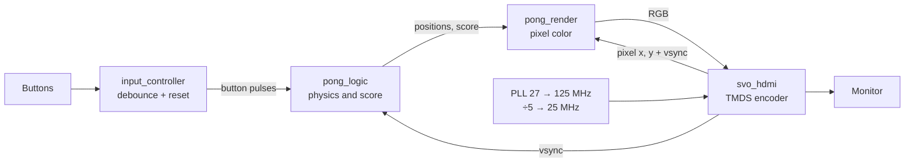

# Pong on an FPGA

Pong written in **Verilog** and running entirely in hardware on a **Sipeed Tang Nano 9K** FPGA (Gowin GW1NR-9), with video sent over **HDMI**. There is no CPU: the game logic, the renderer and the HDMI signal are all digital circuits.

Plug the board into a monitor and the game starts. The paddles bounce on their own between the top and bottom of the screen, and each player has a button that reverses their paddle's direction. First to **5 points** wins.

## Features

- 640×480 @ 60 Hz output over HDMI, using the board's soldered connector.
- The ball speeds up every 5 seconds of play and returns to its initial speed after each point.
- On-screen scoreboard, drawn from a small font ROM.
- Debounced buttons. Holding both for 2 seconds resets the game.

## Architecture

The design is split into independent layers, so the game never touches HDMI details.



| Module | Role |
|---|---|
| [`top.v`](top.v) | Connects everything and generates the clocks: a PLL turns the 27 MHz oscillator into 125 MHz (the HDMI serial clock), and a divider by 5 gives the 25 MHz pixel clock. |
| [`pong_logic.v`](src/game/pong_logic.v) | Ball, paddles, collisions and score. It updates once per frame, on the `vsync` pulse, so the game speed does not depend on the clock. |
| [`pong_render.v`](src/game/pong_render.v) | For each pixel the HDMI module asks for, decides its color: ball, paddle, score digit or background. |
| [`font_rom.v`](src/game/font_rom.v) | 8×16 bitmaps of the digits 0 to 5, drawn at 4× scale. |
| [`input_controller.v`](src/game/input_controller.v) | Button debouncing, plus a counter that detects the 2-second hold used to reset. |
| [`src/hdmi/`](src/hdmi/) | HDMI output, adapted from Sipeed's Tang Nano 9K example. It was reworked into a black box: it outputs the coordinates of the pixel being drawn and takes the color as input. |

## Details worth noting

- **HDMI without a video chip.** The Tang Nano 9K has an HDMI connector but no controller behind it. The FPGA has to produce the signal itself with **TMDS** (Transition-Minimized Differential Signaling), sending each bit serially along with its inverse, which lets the monitor ignore electrical noise. This was by far the hardest part of the project.
- **Predict the next position.** Scoring used to be decided from the ball's current position. When the ball crossed the left wall, the unsigned position went from `0` to `4095` and the point went to the wrong player. The logic now checks where the ball *will be* in the next step, the same way collisions with the walls and paddles are handled.

## Hardware

- Sipeed Tang Nano 9K
- A monitor or TV with an HDMI input
- The two user buttons already on the board

## Building and loading

The project was built with the **Gowin EDA** IDE (project file [`ping_pong.gprj`](ping_pong.gprj)). Pin assignments are in [`constraints.cst`](constraints.cst) and clock constraints in [`hdmi.sdc`](hdmi.sdc). A ready-to-use bitstream is in `impl/pnr/ping_pong.fs`.

On Linux, the Gowin programmer does not work, so load it with [openFPGALoader](https://github.com/trabucayre/openFPGALoader):

```bash
openFPGALoader -b tangnano9k impl/pnr/ping_pong.fs
```